<div align="center">

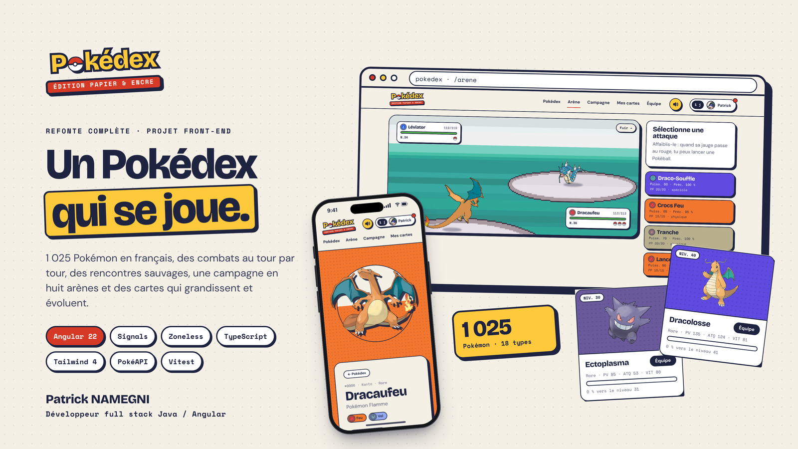

# Pokédex · papier & encre

**Un Pokédex qui se joue.** Les 1 025 Pokémon en français, des combats au tour par tour, des rencontres sauvages,
une campagne en huit arènes et des cartes qui grandissent et évoluent. Sans compte, sans serveur.

[](https://angular.dev)
[](https://www.typescriptlang.org)
[](https://tailwindcss.com)
[](#qualité)
[](https://poke-craft.netlify.app)

[**Voir la démo**](https://poke-craft.netlify.app) · [Fonctionnalités](#fonctionnalités) · [Stack](#stack-technique) · [Architecture](#architecture) · [Démarrer](#démarrer)

</div>

---

## Aperçu

<p align="center">
  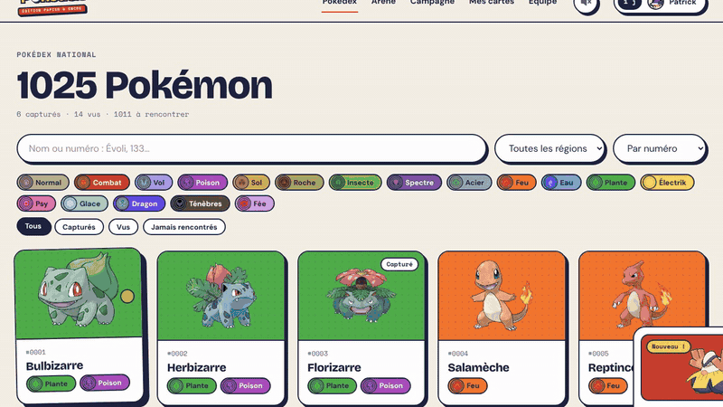
</p>

| Accueil | Pokédex |
| :---: | :---: |
| 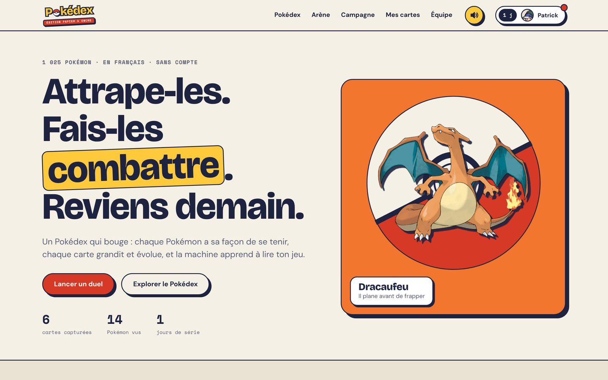 | 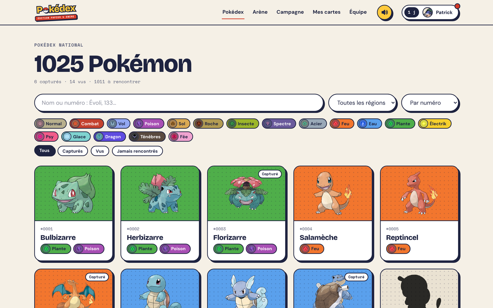 |
| **Fiche Pokémon** | **Arène** |
| 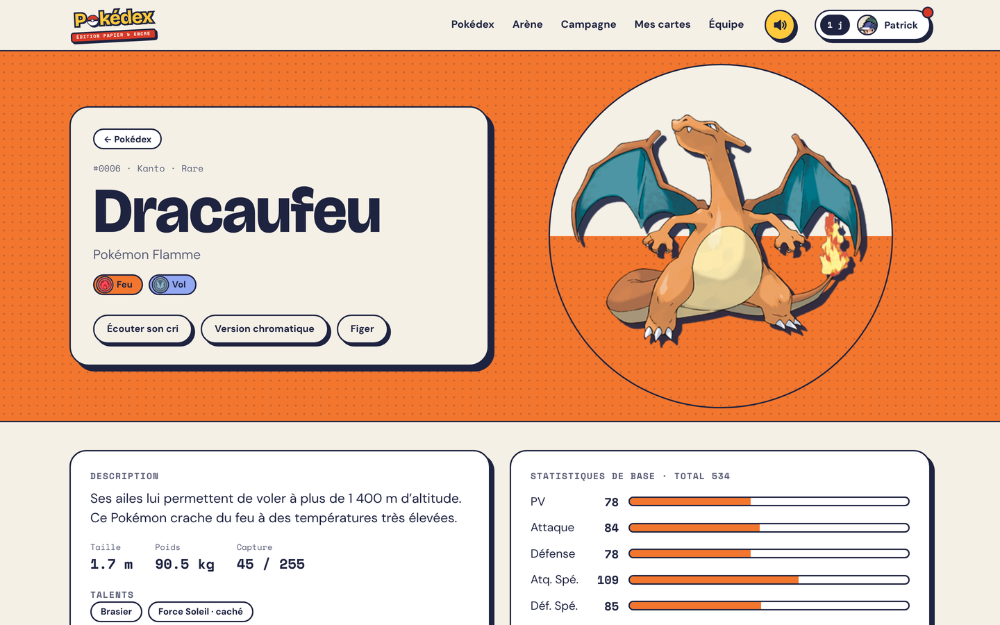 | 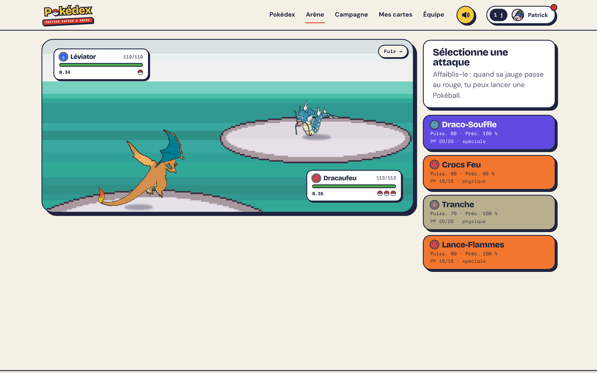 |
| **Campagne** | **Atelier d'équipe** |
| 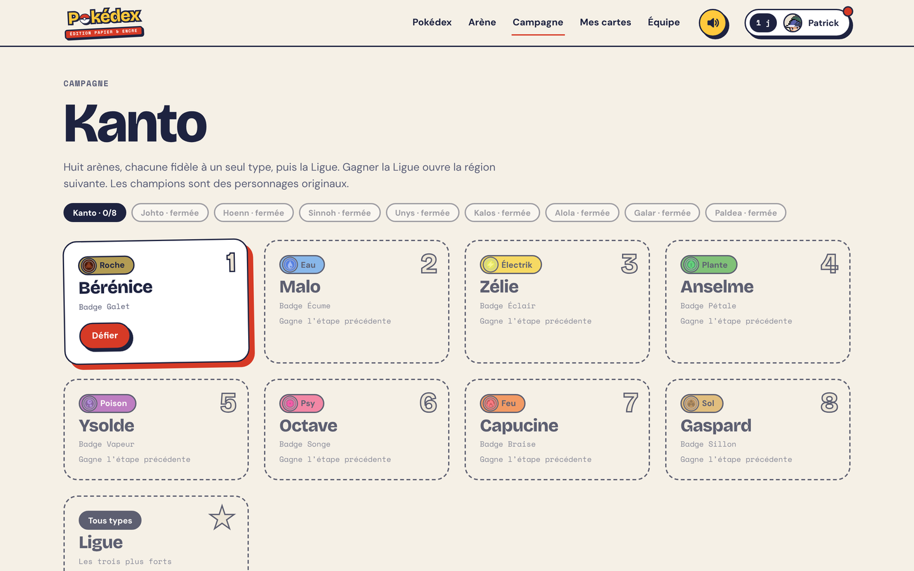 | 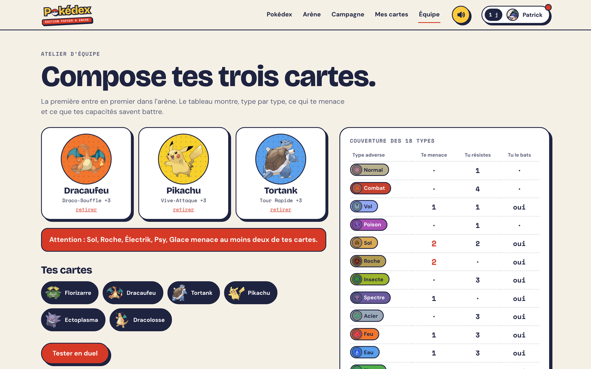 |
| **Collection** | **Mon QG** |
| 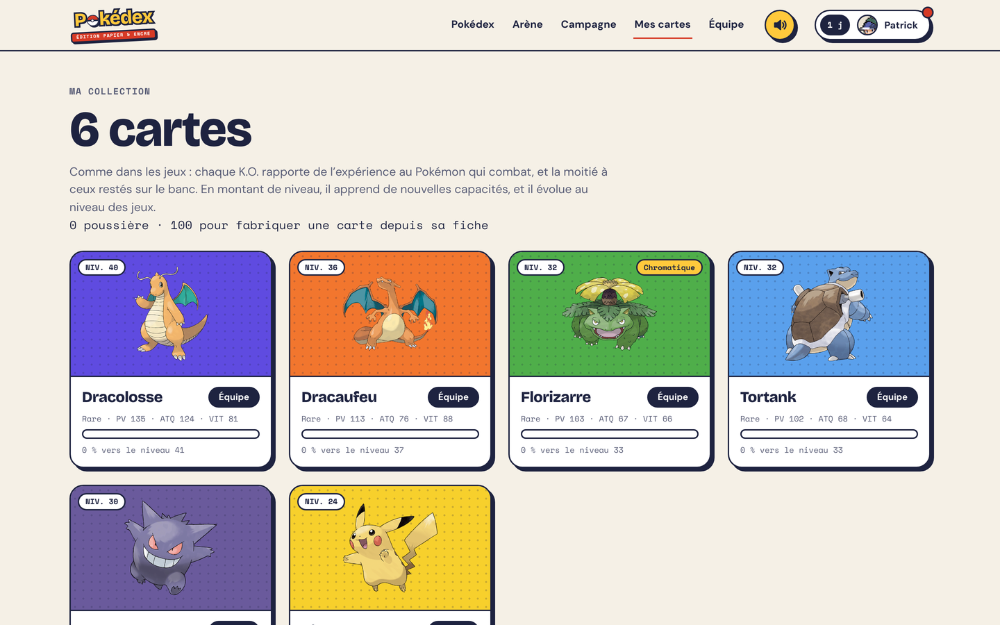 | 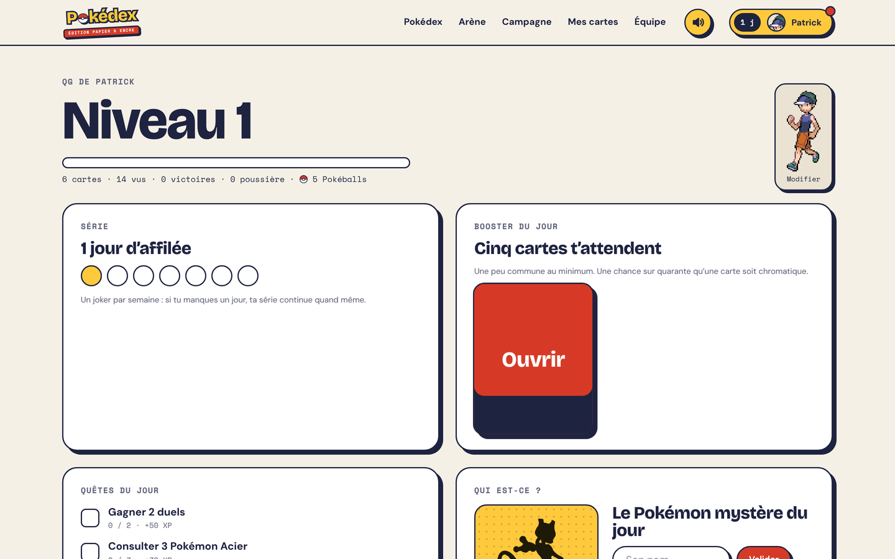 |

<details>
<summary><b>Version mobile</b></summary>
<br />
<p align="center">
  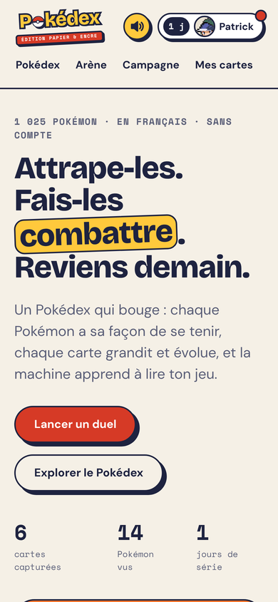
  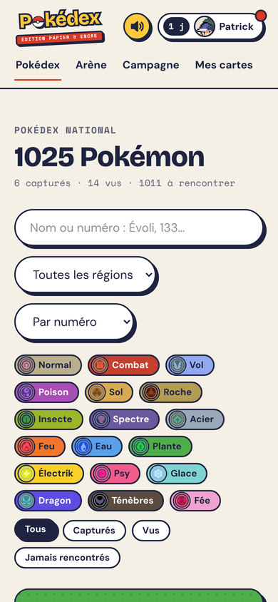
  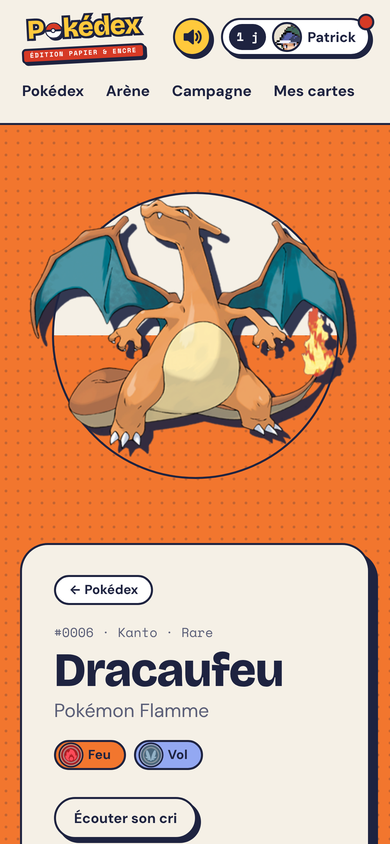
  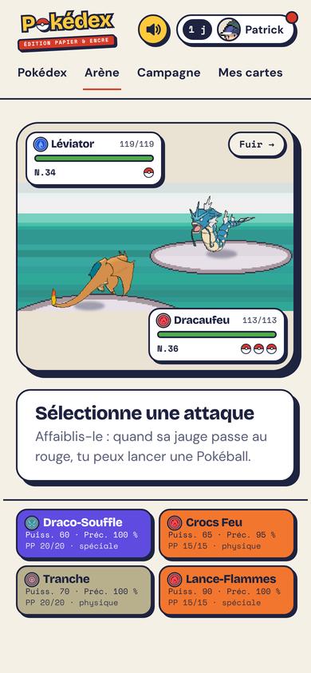
</p>
</details>

## Fonctionnalités

**Encyclopédie**
- Les 1 025 Pokémon en français : recherche instantanée, filtres par type, région et collection, défilement infini.
- Fiche complète : description, statistiques, talents, cri, version chromatique, lignée d'évolution.
- Une « signature de mouvement » calculée pour chaque Pokémon à partir de son poids, sa vitesse et sa silhouette : aucun Pokémon ne bouge comme un autre, sans aucune animation dessinée à la main.

**Combat**
- Duel au tour par tour à la manière des jeux : quatre vraies capacités par Pokémon (puissance, précision, PP), ordre selon la vitesse, coups critiques, efficacité des types.
- Une machine adverse qui choisit ses coups en lisant les types.
- Rencontres sauvages pendant la navigation, avec transition plein écran, capture à la Pokéball (formule de la 4ᵉ génération) et option de fuite.
- 18 terrains de combat choisis selon le type de l'adversaire et l'heure (fonds de nuit).

**Progression**
- Choix du dresseur et du premier Pokémon.
- Vrais niveaux, expérience des jeux, apprentissage de capacités et évolutions (annulables).
- Campagne sur 9 régions, 8 arènes mono-type et une Ligue par région, avec des champions originaux.
- Booster du jour, quêtes, série de jours, Pokémon mystère, « Devine le cri », badges.

**Expérience**
- Musiques et bruitages, coupables en un clic.
- Responsive, du téléphone au grand écran.
- Accessible : navigation au clavier, textes alternatifs, respect de « réduire les animations ».

## Stack technique

| Domaine | Choix |
| --- | --- |
| Framework | **Angular 22** : composants autonomes, **signals**, mode **zoneless**, nouveau control flow (`@if`, `@for`, `@let`) |
| Langage | **TypeScript 6** en mode strict |
| Style | **Tailwind CSS 4** et une charte maison en variables CSS |
| Tests | **Vitest** avec jsdom |
| Données | **PokéAPI** (CSV officiels), précompilées en JSON statique |
| Médias | Sprites et cris de PokéAPI, sprites animés de Pokémon Showdown |
| Hébergement | **Netlify** |

## Architecture

```
scripts/build-data.mjs     génère les données depuis les CSV de PokéAPI
public/data/               index des 1 025 Pokémon, descriptions, talents (JSON)
src/styles.css             charte graphique : couleurs, polices, boutons, mouvements
src/app/core/              services et état : joueur, Pokédex, audio, rencontres
src/app/core/game/         moteur de jeu en fonctions pures : duel, capture, progression, campagne
src/app/ui/                composants réutilisables : carte, pastille de type, logotype, transitions
src/app/pages/             une page par dossier, chargée à la demande
```

**Choix techniques**
- **Données statiques plutôt qu'API au runtime.** Un script lit les CSV de PokéAPI et produit deux fichiers JSON livrés avec le site. La liste, la recherche et le jeu sont instantanés, et l'application fonctionne sans dépendre de la disponibilité d'une API.
- **Moteur de jeu découplé de l'interface.** Duel, capture, expérience et campagne sont des fonctions pures, testées unitairement. Les composants ne font qu'afficher l'état.
- **État réactif par signals.** Un store unique (`PlayerStore`) expose la progression en signals et la persiste dans `localStorage`, avec migration des anciennes sauvegardes.
- **Zoneless et OnPush partout.** Pas de zone.js : la détection de changement ne suit que les signals.
- **Chargement à la demande.** Chaque page est un chunk séparé (`loadComponent`), et des budgets de taille sont imposés au build.

## Démarrer

Prérequis : Node.js 22.22 ou plus récent.

```bash
npm install
npm start        # serveur de développement sur http://localhost:4200
npm test         # tests unitaires (Vitest)
npm run build    # build de production dans dist/pokedex/browser
npm run data     # régénère les données depuis PokéAPI
```

Astuce de démonstration : ajouter `?sauvage=1` à l'adresse d'une page déclenche tout de suite une rencontre sauvage.

## Qualité

- 54 tests unitaires sur le moteur de jeu, le store du joueur, les rencontres et la signature de mouvement.
- TypeScript strict, aucun `any` dans le moteur.
- Budgets de build : avertissement à 8 ko par feuille de style de composant, échec du build à 12 ko.
- Chaque fonctionnalité est développée sur une branche `dev-*` et intégrée par pull request.

## Charte graphique

Papier `#F5F0E6`, encre `#1E2340`, rouge `#D63A26`, jaune `#FFC93C`, et une encre par type.
Titres en Bricolage Grotesque, texte en DM Sans, données en Space Mono.
Contours de 2,5 px, ombres dures sans flou, animations à ressort.

## Crédits

- Données, images et cris : [PokéAPI](https://pokeapi.co).
- Sprites animés : la collection Pokémon Showdown.
- Effets d'attaque : la planche « 100% Custom Pokemon Attack Sheet » de JoshR_691.
- Dresseurs : sprites de Pokémon HeartGold et SoulSilver rassemblés par Dann-The-Yoshi.
- Fonds de combat : la planche « Battle BG's for GBA » de Gold-Ruki.
- Musiques et bruitages : Pokémon HeartGold et SoulSilver, © Nintendo / Game Freak.

## Auteur

**Patrick NAMEGNI**, développeur full stack Java / Angular. Idée, conception et développement.

---

<sub>Projet de fan, sans but commercial. Pokémon et les noms de Pokémon sont des marques de Nintendo, Game Freak et Creatures. Ce site n'est ni affilié ni approuvé par eux.</sub>
